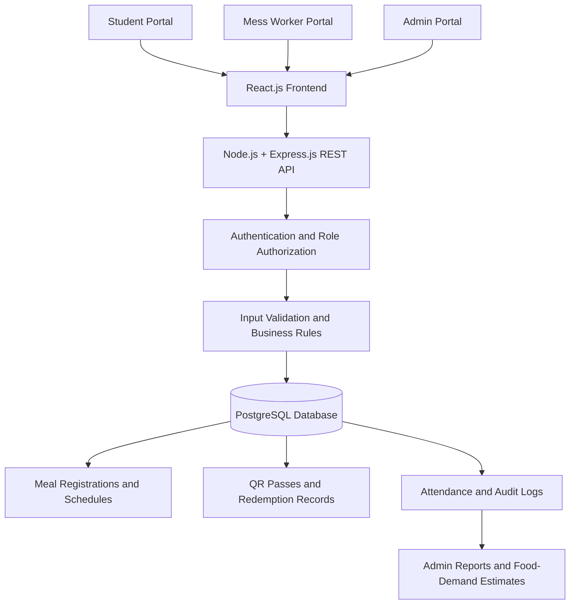

# MessMate — Smart College Mess Management System

**WEBSTER 2026 | CodeSangam 2026**  
**Team:** POWER UPS  
**Team ID:** 311

MessMate is a web-based college mess management platform designed to streamline meal planning, QR-based meal verification, attendance tracking, and food-demand estimation. The system aims to reduce food wastage, prevent duplicate meal check-ins, and improve transparency and accountability in college mess operations.

> **Project status:** Initial frontend prototype and basic backend integration are in progress. Features described as planned are part of the proposed system and should not be considered production-ready until implemented and tested.

## 1. Problem Statement

Traditional college mess management can make it difficult to estimate meal demand accurately, maintain reliable attendance records, and prevent duplicate meal claims. Uncertainty about the number of students attending meals can also contribute to unnecessary food preparation and wastage.

MessMate addresses these challenges through a centralized web application that supports advance meal registration, QR-based verification, reliable attendance recording, and data-driven food preparation estimates.

## 2. Proposed Solution

MessMate will provide separate portals for students, mess workers, and administrators.

- **Students:** View scheduled meals and opt in or out before a fixed cutoff time.
- **Mess workers:** Scan student-specific QR passes, verify eligibility, and confirm that a meal has been served.
- **Administrators:** Monitor registrations, attendance, meal demand, and planned-versus-served meals.

The backend will validate meal passes and enforce redemption rules. Confirmation-based, retry-safe processing will ensure that scanning a QR code alone does not consume a pass, and that refreshes or temporary network interruptions do not result in duplicate attendance records.

## 3. Key Features

### Planned system features

1. **Role-based access:** Separate student, mess worker, and administrator portals.
2. **Meal opt-in/opt-out:** Register or cancel meal attendance before the fixed cutoff time.
3. **Unique QR passes:** Generate meal-specific passes with defined validity windows for eligible students.
4. **QR scanning:** Enable browser-based QR scanning through compatible device cameras.
5. **Server-side validation:** Verify pass authenticity, meal eligibility, validity, and redemption status.
6. **Duplicate scan prevention:** Prevent successful redemption of the same pass more than once.
7. **Fault-tolerant redemption:** Support safe retries after interruptions before meal confirmation.
8. **Meal confirmation:** Record attendance only after the worker confirms that the meal was served.
9. **Attendance tracking:** Update meal counts following successful redemption.
10. **Administrator dashboard:** Display registrations, attendance, and meal-demand statistics.
11. **Food-demand estimation:** Use planned meals and actual check-ins to improve food preparation estimates and minimise wastage.
12. **Audit logs:** Record successful scans, rejected attempts, and authorised corrections.
13. **Responsive interface:** Support mobile phones, tablets, and desktop screens.
14. **Secure data management:** Use protected server-side operations, role-based permissions, and database constraints.

## 4. Technology Stack

| Technology | Purpose |
|---|---|
| React.js | Frontend interfaces and interactive portals |
| Vite | Frontend development server and build tooling |
| HTML and CSS | Page structure and visual styling |
| Node.js | Backend runtime |
| Express.js | REST API and server-side application logic |
| PostgreSQL | Planned persistent relational database |
| `qrcode` | Planned QR pass generation |
| `html5-qrcode` | Planned browser-based QR scanning |
| JWT | Planned authentication token handling |
| Password-hashing library | Planned secure password storage |
| Zod | Planned server-side request validation |

**Important:** PostgreSQL, authentication, QR scanning, and the other planned security mechanisms must be integrated and tested before being described as implemented.

## 5. System Architecture

MessMate is designed around a modular, three-tier web architecture.



*This diagram represents the proposed architecture. PostgreSQL integration and the associated authentication, validation, and reporting layers are planned work until implemented.*

### Core redemption workflow

1. A student logs in and selects a scheduled meal.
2. The backend checks the registration request and cutoff time.
3. For an eligible student, the system generates a unique, meal-specific QR pass.
4. A mess worker scans the pass using the worker portal.
5. The server validates the pass, meal eligibility, validity window, and redemption status.
6. The worker confirms that the meal has been served.
7. The backend records redemption, attendance, and the audit event in a consistent database transaction.
8. The administrator dashboard retrieves updated attendance and meal-demand statistics.

The redemption operation is intended to use atomic database operations and appropriate constraints so that simultaneous scans cannot create multiple successful check-ins.

## 6. Smart Engineering Approach

MessMate is designed to address common reliability issues in basic QR-based attendance systems.

- **Server-side verification:** Critical eligibility and redemption decisions will be made by the backend rather than trusted to the browser.
- **Atomic redemption:** Database transactions and constraints will protect against duplicate attendance records.
- **Confirmation-based processing:** A pass will not be consumed merely because it has been scanned.
- **Safe retries:** Repeated requests following uncertain network outcomes will not create duplicate successful redemptions.
- **Role-based authorization:** Students, workers, and administrators will have access only to permitted operations.
- **Auditability:** Important scan and attendance events will be recorded for traceability.
- **Relational data integrity:** PostgreSQL constraints and transactions will help keep registrations, attendance, and redemption records consistent.

These are intended design properties; they require implementation and testing to verify their behaviour.

## 7. Current Implementation Status

The project is being developed incrementally, starting with the interface and basic frontend-backend communication.

### Implemented in the prototype

- [x] Initial student, mess worker, and admin interface.
- [x] React.js frontend using Vite.
- [x] Basic meal registration and cancellation interactions in the prototype.
- [x] Prototype pass ID generation and duplicate-use handling in the demonstration interface.
- [x] Node.js and Express.js backend setup.
- [x] Basic registration API endpoints.
- [x] Initial frontend-to-backend registration communication tested locally.

### Planned or requiring further integration and testing

- [ ] PostgreSQL database integration and persistent storage.
- [ ] Student, worker, and administrator authentication.
- [ ] JWT authentication and secure password hashing.
- [ ] Server-side role-based authorization.
- [ ] Server-enforced meal registration cutoff times.
- [ ] QR code generation using the `qrcode` package.
- [ ] Camera-based QR scanning using `html5-qrcode`.
- [ ] Server-side QR pass validation and expiry handling.
- [ ] Confirmation-based, retry-safe redemption.
- [ ] Transactional duplicate-redemption prevention.
- [ ] Database-backed attendance and administrator dashboard.
- [ ] Audit logs for successful scans, rejected attempts, and corrections.
- [ ] Data-driven food-demand estimates.
- [ ] End-to-end testing, deployment, and production security checks.

*The current prototype's local demonstration logic should not be confused with the final server-enforced, database-backed system.*

## 8. API Overview

The backend currently provides basic endpoints for application access and meal registration.

| Method | Endpoint | Purpose |
|---|---|---|
| GET | `/` | Check the backend's root response, if configured |
| POST | `/api/registrations` | Submit a meal registration |
| GET | `/api/registrations` | Retrieve registration records |

The exact request fields and responses depend on the current backend implementation. Authentication, pass validation, redemption, and reporting endpoints will be added as the system develops.

## 9. Project Structure

The main project components are organised as follows:

```text
MessMate/
├── frontend/
│   ├── src/
│   │   ├── App.jsx
│   │   └── main.jsx
│   ├── index.html
│   ├── style.css
│   └── package.json
├── backend/
│   ├── server.js
│   ├── test-api.http
│   └── package.json
├── prd.md
├── trd.md
└── README.md
```

*This is a representative structure; additional files and folders may exist in the repository.*

## 10. Running the Project Locally

### Prerequisites

- Node.js and npm installed.
- The project repository cloned or downloaded.
- Dependencies installed in both the frontend and backend directories.

### Start the backend

Open a terminal in the project directory and run:

```bash
cd backend
npm install
node server.js
```

The backend should start on `http://localhost:3000` if configured to use port 3000.

### Start the frontend

Open a second terminal and run:

```bash
cd frontend
npm install
npm run dev
```

Open the local URL printed by Vite in the terminal, typically `http://localhost:5173`.

Keep both terminals running while testing frontend-backend communication.

**Note:** The current backend may use in-memory storage. If so, registration records will not persist after the server restarts. PostgreSQL setup is part of the planned implementation.

## 11. Testing

The prototype has been tested for basic interface interactions and registration flows. Further testing is required before the complete system can be considered reliable.

Planned testing includes:

- Valid and invalid meal registration requests.
- Registration cutoff enforcement.
- Invalid, expired, and meal-mismatched QR passes.
- Duplicate scans and simultaneous redemption attempts.
- Refreshes and network interruptions before and after meal confirmation.
- Role-based access restrictions.
- Attendance consistency and audit-log correctness.
- Database persistence and recovery.
- Responsive behaviour across supported devices.

## 12. Future Scope

- Complete PostgreSQL integration and database migrations.
- Implement secure authentication and role-based access control.
- Integrate real QR generation and camera-based scanning.
- Implement atomic, retry-safe meal redemption.
- Build database-backed administrative reports.
- Improve food-demand forecasting using historical meal registrations and attendance.
- Add automated tests, deployment monitoring, backups, and recovery procedures.

The initial implementation will remain a modular application rather than introducing unnecessary microservice complexity. Further scaling and deployment improvements can be introduced when actual requirements justify them.

## 13. Team

**Team Name:** POWER UPS  
**Team ID:** 311  
**Event:** WEBSTER 2026 — CodeSangam 2026

- **Shachi Tiwari** — Biotechnology
- **Shreya Verma** — Biotechnology

## 14. Project Documentation

- [Product Requirements Document](prd.md)
- [Technical Requirements Document](trd.md)

---

MessMate aims to make college mess operations more reliable, transparent, and resource-efficient through advance meal planning, secure QR-based verification, dependable attendance records, and better food-demand estimates.
